# Patternfolio

Patternfolio generates vector patterns for pages and books. Make a Penrose tiling, weave a Celtic border, lay out an Islamic star pattern, turn text into micrography, or grow a botanical margin. The command line, browser studio, and LuaLaTeX and XeLaTeX adapters share the same Lua generators. Export PDF and SVG, or keep the recipe and result folder to reproduce a design.

The 22-pattern platform shown here is available as a release candidate. The default branch contains the original floral package. [Pattern platform PR](https://github.com/UPerna/patternfolio/pull/2) · [Original floral package guide](https://github.com/kevinraymond/florilegium/blob/main/README.md)


*Compass Garden adds compass stars across shared edges of a Penrose P3 patch. The collection also includes a Celtic knot with a botanical attachment and a coordinated two-page book design.* [Collection guide](https://github.com/UPerna/patternfolio/blob/8cdfdb52dfe84ac94a94058ed2dacd947ed559c8/docs/design/ORIGINAL-COLLECTIONS.md)

## Pattern catalog

Each preview shows the canonical output of its linked recipe. The Pattern Atlas also includes presentation variants, full-size PDF and SVG files, and complete replay bundles. [Atlas guide](https://github.com/UPerna/patternfolio/blob/8cdfdb52dfe84ac94a94058ed2dacd947ed559c8/docs/GALLERY.md) · [Source methods and supported scope](https://github.com/UPerna/patternfolio/blob/8cdfdb52dfe84ac94a94058ed2dacd947ed559c8/docs/research/SOURCES.md)

| Category | Pattern | What the example makes | Preview |
| --- | --- | --- | --- |
| Tilings | [Periodic repeat](https://github.com/UPerna/patternfolio/blob/8cdfdb52dfe84ac94a94058ed2dacd947ed559c8/examples/cli/periodic.recipe) | A repeating patch with a protected opening in a fixed page frame | 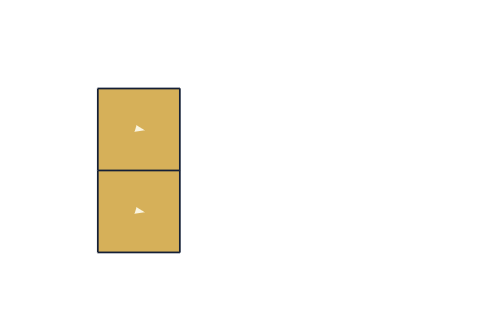 |
| Tilings | [Chair substitution](https://github.com/UPerna/patternfolio/blob/8cdfdb52dfe84ac94a94058ed2dacd947ed559c8/examples/cli/substitution.recipe) | A finite chair patch that records each tile's place in the substitution hierarchy | 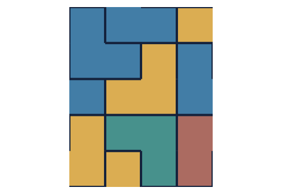 |
| Tilings | [Penrose P3](https://github.com/UPerna/patternfolio/blob/8cdfdb52dfe84ac94a94058ed2dacd947ed559c8/examples/cli/penrose.recipe) | Thin and thick rhombs constructed from a pentagrid | 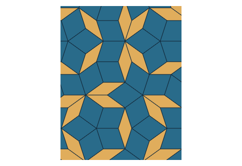 |
| Tilings | [Ammann–Beenker](https://github.com/UPerna/patternfolio/blob/8cdfdb52dfe84ac94a94058ed2dacd947ed559c8/examples/cli/beenker.recipe) | Squares and rhombs constructed from a tetragrid | 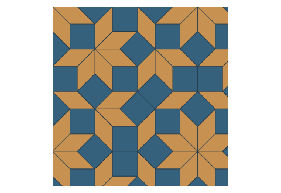 |
| Tilings | [Hat](https://github.com/UPerna/patternfolio/blob/8cdfdb52dfe84ac94a94058ed2dacd947ed559c8/examples/cli/hat.recipe) | A finite Hat cluster with prototype labels and an outline | 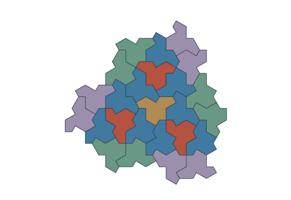 |
| Tilings | [Spectre](https://github.com/UPerna/patternfolio/blob/8cdfdb52dfe84ac94a94058ed2dacd947ed559c8/examples/cli/spectre.recipe) | A finite Spectre patch with matching curved seams | 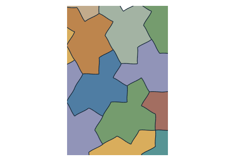 |
| Tilings | [Marked square completion](https://github.com/UPerna/patternfolio/blob/8cdfdb52dfe84ac94a94058ed2dacd947ed559c8/examples/cli/completion.recipe) | A bounded square-grid solve with matching edge marks | 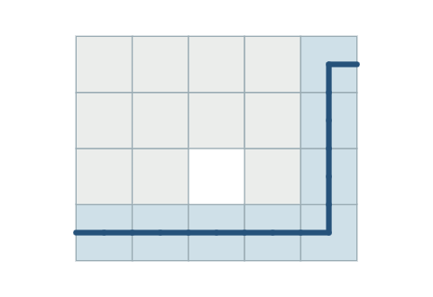 |
| Tilings | [Escherization](https://github.com/UPerna/patternfolio/blob/8cdfdb52dfe84ac94a94058ed2dacd947ed559c8/examples/cli/escher.recipe) | A periodic design rendered from a saved, verified solution | 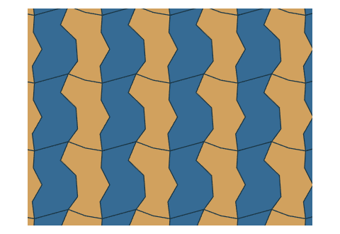 |
| Linework | [Celtic knotwork](https://github.com/UPerna/patternfolio/blob/8cdfdb52dfe84ac94a94058ed2dacd947ed559c8/examples/cli/celtic.recipe) | A strand design with validated over and under crossings |  |
| Linework | [Classical Islamic ornament](https://github.com/UPerna/patternfolio/blob/8cdfdb52dfe84ac94a94058ed2dacd947ed559c8/examples/cli/islamic.recipe) | Star linework inferred from polygons in contact | 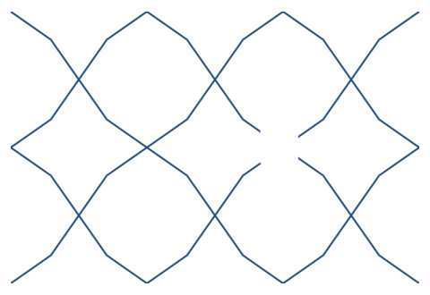 |
| Linework | [Freeform Islamic ornament](https://github.com/UPerna/patternfolio/blob/8cdfdb52dfe84ac94a94058ed2dacd947ed559c8/examples/cli/freeform.recipe) | Mixed star orders on a finite circle-packing scaffold |  |
| Linework | [Gothic tracery](https://github.com/UPerna/patternfolio/blob/8cdfdb52dfe84ac94a94058ed2dacd947ed559c8/examples/cli/tracery.recipe) | A two-dimensional construction of arches and foils |  |
| Linework | [Spatial Gothic ogees](https://github.com/UPerna/patternfolio/blob/8cdfdb52dfe84ac94a94058ed2dacd947ed559c8/examples/cli/gothic-spatial.recipe) | A projected view of a 3D curve network, with the network saved separately | 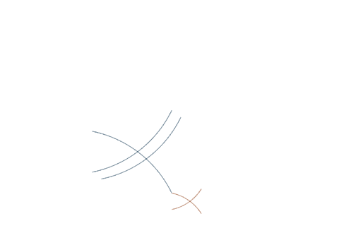 |
| Surface and stroke | [Mosaic](https://github.com/UPerna/patternfolio/blob/8cdfdb52dfe84ac94a94058ed2dacd947ed559c8/examples/cli/mosaic.recipe) | Field-guided tile placement with visible grout and a recorded partial packing | 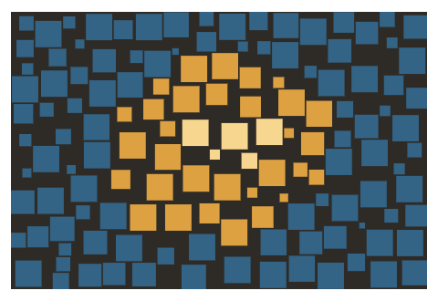 |
| Surface and stroke | [Hatching and stippling](https://github.com/UPerna/patternfolio/blob/8cdfdb52dfe84ac94a94058ed2dacd947ed559c8/examples/cli/stroke.recipe) | Field-guided hatching from a family that also supports stippling and example-driven strokes | 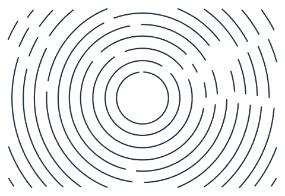 |
| Surface and stroke | [Tone-guided maze](https://github.com/UPerna/patternfolio/blob/8cdfdb52dfe84ac94a94058ed2dacd947ed559c8/examples/cli/maze.recipe) | A finite maze whose tone field controls spacing and stroke weight | 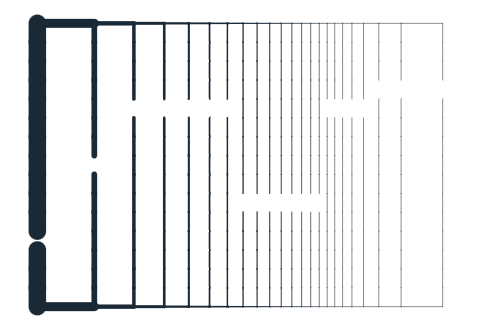 |
| Surface and stroke | [DecoBrush](https://github.com/UPerna/patternfolio/blob/8cdfdb52dfe84ac94a94058ed2dacd947ed559c8/examples/cli/decobrush.recipe) | A decorative brush synthesized from an exemplar library |  |
| Text and page ornament | [Micrography](https://github.com/UPerna/patternfolio/blob/8cdfdb52dfe84ac94a94058ed2dacd947ed559c8/examples/cli/micrography.recipe) | Text arranged as vector linework with searchable reading order | 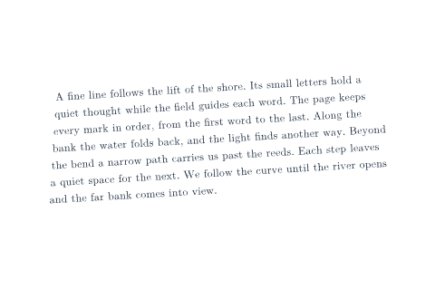 |
| Text and page ornament | [Inline ornament](https://github.com/UPerna/patternfolio/blob/8cdfdb52dfe84ac94a94058ed2dacd947ed559c8/examples/cli/inline.recipe) | A divider placed at a specified physical size | 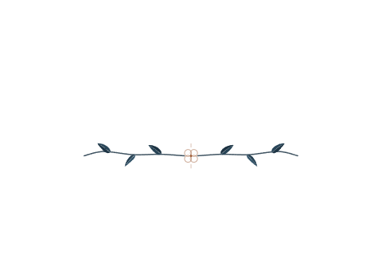 |
| Botanical | [Asymmetric garden](https://github.com/UPerna/patternfolio/blob/8cdfdb52dfe84ac94a94058ed2dacd947ed559c8/examples/cli/botanical-panel.recipe) | An adaptive botanical panel with an opening reserved for content | 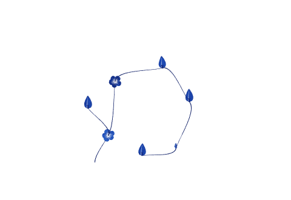 |
| Botanical | [Authored floral margin](https://github.com/UPerna/patternfolio/blob/8cdfdb52dfe84ac94a94058ed2dacd947ed559c8/examples/cli/botanical-authored.recipe) | The original hand-placed floral composition with seeded variations | 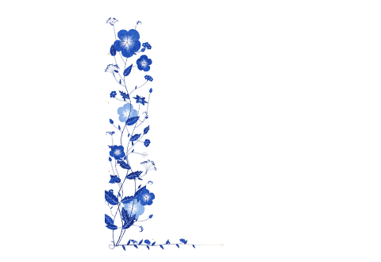 |
| Botanical | [Grown floral margin](https://github.com/UPerna/patternfolio/blob/8cdfdb52dfe84ac94a94058ed2dacd947ed559c8/examples/cli/botanical-grown.recipe) | A seeded floral composition that grows into the available page area | 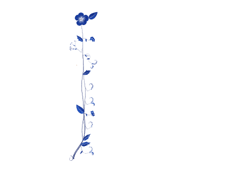 |

## Get started

The verified candidate download contains source, browser, and atlas ZIPs with SHA-256 manifests. It was built from commit `8cdfdb52dfe84ac94a94058ed2dacd947ed559c8`. Extract the atlas ZIP and open `index.html` to explore the gallery. [Download the candidate packages (GitHub sign-in required)](https://github.com/UPerna/patternfolio/actions/runs/42356202542/artifacts/13569855046) · [Download the source snapshot](https://github.com/UPerna/patternfolio/archive/8cdfdb52dfe84ac94a94058ed2dacd947ed559c8.zip) · [Build and checksums](https://github.com/UPerna/patternfolio/blob/8cdfdb52dfe84ac94a94058ed2dacd947ed559c8/docs/RELEASE-CANDIDATE.md)

### Use the browser studio

Extract the browser ZIP. From the directory containing `florilegium-browser`, serve it with Python 3.11 or later.

```sh
python3 -m http.server 8000 --bind 127.0.0.1 --directory florilegium-browser
```

Open `http://127.0.0.1:8000/`, choose a recipe, and select **Generate structure**. Adjust the view or paint, export PDF or SVG, or save a workspace to retain your result and edits. From a pattern platform checkout, run `python3 tools/webpackage.py` and serve `build/web` in the same way. [Browser studio guide](https://github.com/UPerna/patternfolio/blob/8cdfdb52dfe84ac94a94058ed2dacd947ed559c8/docs/browser-editor.md)

### Generate and replay from the command line

Use Python 3.11 or later and put TeX Live's `texlua` on your command path. Run these commands from the extracted candidate source folder or a checkout of `pattern/common-platform`. Choose new output directories each time.

```sh
python3 tools/pattern.py generate examples/cli/penrose.recipe --output build/penrose
python3 tools/pattern.py replay --from build/penrose --output build/penrose-replay
```

Open `pattern.pdf` or `pattern.svg` in `build/penrose`. The recipe specifies the inputs and seed. The instance records the generated geometry. Keep the complete output folder for replay, including any companion files. Substitute any recipe from the catalog to generate another pattern. [CLI reference](https://github.com/UPerna/patternfolio/blob/8cdfdb52dfe84ac94a94058ed2dacd947ed559c8/docs/CLI.md)

### Place patterns in a TeX document

Build the shared example book with the TeX Live engine of your choice. The driver manages the passes that settle page placement and prepares vectors between XeLaTeX passes.

```sh
python3 tools/build.py examples/patterns/book.tex --engine lua --output-dir build/lua-book
python3 tools/build.py examples/patterns/book.tex --engine xe --output-dir build/xe-book
```

Open `book.pdf` in the corresponding output folder. For a floral book template, see [`examples/book.tex`](https://github.com/UPerna/patternfolio/blob/8cdfdb52dfe84ac94a94058ed2dacd947ed559c8/examples/book.tex) and [`folio-demo.tex`](https://github.com/UPerna/patternfolio/blob/8cdfdb52dfe84ac94a94058ed2dacd947ed559c8/folio-demo.tex). [LuaLaTeX guide](https://github.com/UPerna/patternfolio/blob/8cdfdb52dfe84ac94a94058ed2dacd947ed559c8/docs/LUALATEX-PATTERNS.md) · [XeLaTeX guide](https://github.com/UPerna/patternfolio/blob/8cdfdb52dfe84ac94a94058ed2dacd947ed559c8/docs/XELATEX-PATTERNS.md)

## Verification and licenses

The candidate build exercised all 22 profiles, both TeX adapters, and the shipped browser files in Chromium. The coverage ledger links each capability to its evidence. The compatibility guide explains tested environments, finite construction limits, and the comparison rules for outputs. [Candidate build](https://github.com/UPerna/patternfolio/actions/runs/42356202542) · [Coverage ledger](https://github.com/UPerna/patternfolio/blob/8cdfdb52dfe84ac94a94058ed2dacd947ed559c8/docs/research/COVERAGE.csv) · [Compatibility](https://github.com/UPerna/patternfolio/blob/8cdfdb52dfe84ac94a94058ed2dacd947ed559c8/docs/COMPATIBILITY.md)

Florilegium code and its original examples are MIT licensed. The source includes separate notices for borrowed substitution tables, fonts, and browser dependencies. [MIT license](https://github.com/UPerna/patternfolio/blob/8cdfdb52dfe84ac94a94058ed2dacd947ed559c8/LICENSE) · [Third-party notices](https://github.com/UPerna/patternfolio/blob/8cdfdb52dfe84ac94a94058ed2dacd947ed559c8/docs/COMPATIBILITY.md#compatibility-comparisons-and-licenses) · [Adding a pattern family](https://github.com/UPerna/patternfolio/blob/8cdfdb52dfe84ac94a94058ed2dacd947ed559c8/docs/ADDING-A-FAMILY.md)
