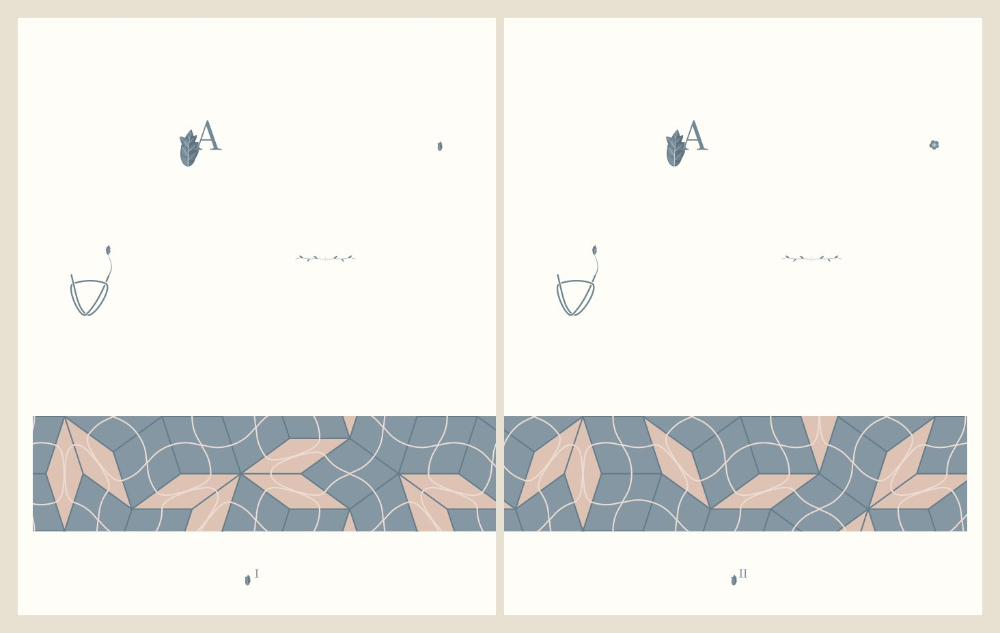

# Patternfolio

**Make reproducible vector ornaments for books and pages.** Generate a Penrose tiling, grow a botanical border, or turn text into micrography. Export an SVG or PDF and keep the recipe to make the same design again.

[**Try the browser demo**](https://uperna.github.io/patternfolio/) · [Open the full studio](https://uperna.github.io/patternfolio/studio/) · [Browse all 22 patterns](PATTERNS.md)

[](https://uperna.github.io/patternfolio/#collection-title)

*Compass Garden uses one Penrose tiling across two facing pages, with compass stars meeting at shared tile edges.* [How the spread was made](https://github.com/UPerna/patternfolio/blob/8cdfdb52dfe84ac94a94058ed2dacd947ed559c8/docs/design/ORIGINAL-COLLECTIONS.md)

## Make your first pattern

1. [Open the demo](https://uperna.github.io/patternfolio/) and choose a Penrose phase or enter a botanical seed.
2. Select **Generate pattern**, then **Download SVG**.
3. Copy or download the recipe to reuse it. For all 22 patterns and PDF export, use the [full studio](https://uperna.github.io/patternfolio/studio/).

## Run it locally

| Use | Start here |
| --- | --- |
| Browser studio | [Offline package and setup](https://github.com/UPerna/patternfolio/blob/8cdfdb52dfe84ac94a94058ed2dacd947ed559c8/docs/RELEASE-CANDIDATE.md) |
| Command line | [Quickstart](https://github.com/UPerna/patternfolio/blob/8cdfdb52dfe84ac94a94058ed2dacd947ed559c8/docs/QUICKSTART.md) · [CLI reference](https://github.com/UPerna/patternfolio/blob/8cdfdb52dfe84ac94a94058ed2dacd947ed559c8/docs/CLI.md) |
| TeX documents | [LuaLaTeX guide](https://github.com/UPerna/patternfolio/blob/8cdfdb52dfe84ac94a94058ed2dacd947ed559c8/docs/LUALATEX-PATTERNS.md) · [XeLaTeX guide](https://github.com/UPerna/patternfolio/blob/8cdfdb52dfe84ac94a94058ed2dacd947ed559c8/docs/XELATEX-PATTERNS.md) |
| Pattern Atlas | [Atlas guide](https://github.com/UPerna/patternfolio/blob/8cdfdb52dfe84ac94a94058ed2dacd947ed559c8/docs/GALLERY.md) · [Pattern catalog](PATTERNS.md) |

[Download source ZIP](https://github.com/UPerna/patternfolio/archive/8cdfdb52dfe84ac94a94058ed2dacd947ed559c8.zip) · [Download verified source, studio, and Atlas packages (GitHub sign-in)](https://github.com/UPerna/patternfolio/actions/runs/42356202542/artifacts/13569855046)

## Project status

The 22-pattern platform is available as a [release candidate](https://github.com/UPerna/patternfolio/pull/2). Clone the platform branch for local development.

```sh
git clone --branch pattern/common-platform https://github.com/UPerna/patternfolio.git
```

The default branch contains the original floral package. Patternfolio builds on Kevin Raymond’s [Florilegium](https://github.com/kevinraymond/florilegium). [MIT license](LICENSE) · [Third-party notices and compatibility](https://github.com/UPerna/patternfolio/blob/8cdfdb52dfe84ac94a94058ed2dacd947ed559c8/docs/COMPATIBILITY.md) · [Verified build](https://github.com/UPerna/patternfolio/actions/runs/42356202542)
